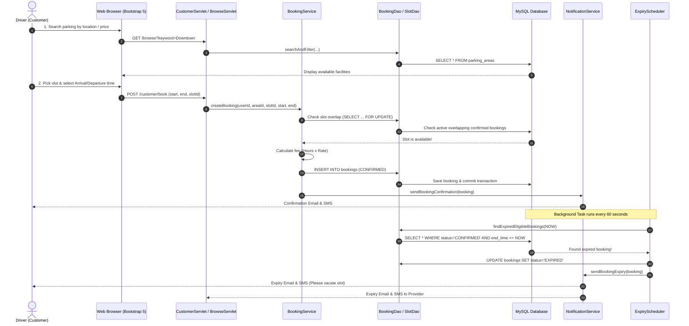

# HELPING_ME.md - Student Guide & Viva Preparation Manual

Welcome! This guide is written in plain, straightforward English specifically for students, educators, and beginner developers. It walks you through every single concept, workflow, file, and line of architecture so you can run, explain, defend, and modify this project with absolute confidence during your project demonstration or viva exam.

---

## 1. What Problem Does This Application Solve?

Drivers waste time, burn gasoline, and create city traffic jams trying to find available parking spots. At the same time, parking facility owners track parking bays and customer logs manually using paper notebooks, spreadsheets, or phone calls.

**Smart Parking Management System** solves this by:
1. Giving drivers an online search tool to discover parking areas, see prices, and reserve specific slots in advance.
2. Giving parking lot owners a dashboard to manage their facilities, add bays, set prices, and view customer reservations.
3. Automatically detecting when a booking has expired and alerting both the customer and provider via Email and SMS.

---

## 2. Complete End-to-End Workflow Diagram



---

## 3. What Does Each Technology Do?

* **Java (JDK 17/25)**: The core programming language running on the server. Handles calculations, transactions, validation, and background scheduling.
* **Apache Tomcat (10.1.59)**: The web server and servlet container. It listens for incoming HTTP browser requests (port 8080) and hands them to our Java Servlets.
* **Jakarta Servlets (Servlet 6.0)**: Java classes that act as the Controllers. They receive HTTP `GET` and `POST` requests, call the business services, and forward data to the JSP pages.
* **JSP (JavaServer Pages 3.1)**: HTML templates embedded with dynamic tags (`${...}`) to render pages in the browser.
* **JDBC (Java Database Connectivity)**: The standard Java library that opens connections, sends SQL queries, and reads data from MySQL.
* **MySQL 8.0**: The relational database that securely stores our users, parking areas, slots, bookings, and notification logs.
* **BCrypt**: A cryptographic algorithm that scrambles user passwords with salt before saving them to the database.
* **Bootstrap 5.3.3**: A modern CSS framework that makes every webpage adapt seamlessly to phones, tablets, laptops, and desktop screens.
* **JUnit 5**: The testing library that automatically runs 22 test cases to verify that our fee calculation, password hashing, and booking logic have zero bugs.

---

## 4. How Does the Browser Talk to Java?

1. You click a button or submit a form in your browser.
2. The browser creates an **HTTP Request** (e.g., `POST /customer/book`) and sends it over the network to port 8080.
3. Apache Tomcat receives the request, sees the URL `/customer/book`, and passes it to `CustomerServlet.java`.
4. The Servlet reads the parameters (like `startTime` and `slotId`), calls `BookingService.java`, which talks to MySQL via `BookingDao.java`.
5. The Servlet puts the resulting `Booking` object into the request attributes (`request.setAttribute("booking", booking)`).
6. The Servlet forwards the request to `booking-confirmation.jsp`.
7. Tomcat renders the JSP into pure HTML/CSS and sends an **HTTP Response** back to the browser.
8. The browser displays the finished webpage to the user.

---

## 5. How MVC, Services, DAOs, and MySQL Work Together

```
[ JSP View ] ◄── (HTML) ── [ Servlet Controller ] ── (Calls) ──► [ Service Layer ] ── (Calls) ──► [ DAO Layer ] ── (SQL) ──► [ MySQL DB ]
```

* **Model (`com.smartparking.model`)**: Java classes that represent our database entities (e.g., `Booking.java`, `User.java`, `ParkingSlot.java`).
* **View (`WEB-INF/views/`)**: JSP files containing the HTML and Bootstrap design.
* **Controller (`com.smartparking.controller`)**: Servlets that handle HTTP requests and choose which view to show.
* **Service (`com.smartparking.service`)**: The "brain" of the app. Contains the business rules, fee calculation, and transaction logic.
* **DAO (`com.smartparking.dao`)**: Data Access Objects. The only classes that write SQL queries (`SELECT`, `INSERT`, `UPDATE`).
* **Util (`com.smartparking.util`)**: Helpers like `PasswordUtil`, `FeeCalculator`, `ValidationUtil`, and `DateTimeUtil`.

---

## 6. Directory and File Reference

* `src/main/resources/db.properties`: Contains database connection settings and flags for email and SMS.
* `src/main/java/com/smartparking/util/FeeCalculator.java`: Computes parking fees using duration in hours multiplied by price per hour.
* `src/main/java/com/smartparking/util/PasswordUtil.java`: Hashes and verifies passwords using BCrypt.
* `src/main/java/com/smartparking/scheduler/ExpiryScheduler.java`: Background daemon that runs every 60 seconds to detect expired bookings.
* `src/main/java/com/smartparking/filter/AuthFilter.java`: Stops unauthenticated or unauthorized users from visiting protected pages.
* `src/main/java/com/smartparking/filter/CsrfFilter.java`: Protects forms from Cross-Site Request Forgery attacks.
* `build.ps1`: Automated build script that compiles Java, runs tests, and packages `smart-parking.war`.

---

## 7. How to Install and Run the Project for the First Time

### Step 1: Open Terminal in the Project Folder
Open PowerShell in `c:\Users\Lenovo\OneDrive\Desktop\smart_parking_system`.

### Step 2: Create the Database
Make sure MySQL is running, then import the database schema and sample data:
```powershell
& "C:\Program Files\MySQL\MySQL Server 8.0\bin\mysql.exe" -u root -p < database/schema.sql
& "C:\Program Files\MySQL\MySQL Server 8.0\bin\mysql.exe" -u root -p < database/sample_data.sql
```

### Step 3: Build the Project and Run Tests
Run the build script:
```powershell
.\build.ps1
```
You will see all 22 tests execute and pass, ending with:
`BUILD SUCCESS! target/smart-parking.war`

### Step 4: Deploy to Apache Tomcat
Copy the generated WAR file into Tomcat's `webapps` folder:
```powershell
Copy-Item "target/smart-parking.war" -Destination "C:\apache-tomcat-10.1.59\webapps\" -Force
```

### Step 5: Start Tomcat
```powershell
& "C:\apache-tomcat-10.1.59\bin\startup.bat"
```

### Step 6: Open the Application in Your Browser
Open:
```
http://localhost:8080/smart-parking/
```

---

## 8. Pre-Configured Test Accounts

All sample accounts are pre-seeded with the password: **`Password@123`**

| Role | Name | Email | Password | Purpose |
| :--- | :--- | :--- | :--- | :--- |
| **Driver / Customer** | Alice Driver | `customer@smartparking.com` | `Password@123` | Search parking, reserve slots, cancel bookings |
| **Driver / Customer** | Bob Miller | `bob@smartparking.com` | `Password@123` | Second customer for testing multi-user bookings |
| **Parking Provider** | John Provider | `provider@smartparking.com` | `Password@123` | Manages Downtown Central Plaza & Airport Express Lot |
| **Parking Provider** | Metro Park Corp | `metro@smartparking.com` | `Password@123` | Manages Metro Tech Hub Garage |
| **Administrator** | System Admin | `admin@smartparking.com` | `Password@123` | System oversight |

*Tip: The login page includes one-click "Driver Demo" and "Provider Demo" buttons that fill in these credentials automatically!*

---

## 9. How is the Parking Fee Calculated?

Located in `src/main/java/com/smartparking/util/FeeCalculator.java`:
1. **Duration**: Calculated in minutes between arrival (start) and departure (end).
2. **Billable Hours**: `minutes / 60.0`, rounded to 2 decimal places using `HALF_UP`.
3. **Minimum Policy**: If duration is under 30 minutes, it is billed at the 0.50 hour minimum.
4. **Formula**:
   $$\text{Estimated Fee} = \text{Billable Hours} \times \text{Price Per Hour}$$
5. **Security**: The calculation is strictly re-computed on the server side. The system never trusts a fee sent from the browser.

---

## 10. How are Overlapping Bookings Prevented?

In `src/main/java/com/smartparking/service/BookingService.java`:
1. When a user submits a booking, the service begins a database transaction: `conn.setAutoCommit(false)`.
2. It queries MySQL with row-level locking:
   ```sql
   SELECT 1 FROM bookings
   WHERE slot_id = ? AND booking_status = 'CONFIRMED'
   AND start_time < ? AND end_time > ?
   LIMIT 1 FOR UPDATE;
   ```
3. If any overlapping confirmed reservation is found, the transaction rolls back immediately and returns an error to the user:
   *"Slot was just reserved by another customer. Please choose another slot or time."*
4. If no overlap exists, the new booking is inserted and committed. This guarantees zero double-booking even if two users click "Reserve" at the exact same millisecond.

---

## 11. How Does Cancellation Work?

* Only bookings that are currently `CONFIRMED` and whose start time is still in the future can be cancelled.
* Active (already started), expired, or completed bookings cannot be cancelled.
* When cancelled, the status updates to `CANCELLED` and `cancelled_at` is recorded.
* The slot interval is immediately freed up for other drivers.
* The booking history is preserved in MySQL for auditing and receipts.

---

## 12. How Does the Background Expiry Scheduler Work?

* Defined in `src/main/java/com/smartparking/scheduler/ExpiryScheduler.java`.
* Starts automatically when Tomcat starts up via `AppLifecycleListener.java`.
* Uses Java's `ScheduledExecutorService` running every 60 seconds.
* Queries the database for bookings where `booking_status = 'CONFIRMED'` and `end_time <= NOW()`.
* Automatically updates the status to `EXPIRED`.
* Triggers 4 distinct notifications:
  1. Customer Email
  2. Customer SMS
  3. Provider Email
  4. Provider SMS
* Database uniqueness constraint `uk_notification_idempotency` ensures that notifications are never duplicated across scheduler runs or Tomcat restarts.

---

## 13. How Do Email and SMS Work in Development Mode?

* By default, `mail.enabled=false` and `sms.enabled=false` in `db.properties`.
* When a notification is triggered, `EmailService` and `SmsService` print the message to the console and record it in MySQL with status `SIMULATED`.
* The system **never** marks a simulated message as `SENT`.
* Both Customers and Providers can view their simulated alerts under the **Notifications** menu in the application.
* When real credentials are ready, simply set `mail.enabled=true` with your SMTP details or `sms.enabled=true` with your Twilio account SID/token in `db.properties`.

---

## 14. How to Read Application and Tomcat Logs

* **Tomcat Standard Output**: `C:\apache-tomcat-10.1.59\logs\catalina.out` or the console window that opens when running `startup.bat`.
* **Application Logs**: Look for lines starting with `[SIMULATED EMAIL]`, `[SIMULATED SMS]`, or `ExpiryScheduler:`.

---

## 15. Frequently Asked Questions for Viva / Demonstration

### Q1: What architecture does this application follow?
> **Answer**: It follows the standard **MVC (Model-View-Controller)** pattern. Servlets act as Controllers, JSPs act as Views, and Java domain objects act as Models. It also uses a dedicated Service layer for business logic and a DAO layer for JDBC database queries.

### Q2: Why did you use PreparedStatement instead of Statement?
> **Answer**: `PreparedStatement` pre-compiles the SQL query and binds parameters safely using placeholders (`?`). This prevents **SQL Injection** attacks and improves database query execution efficiency.

### Q3: How do you prevent double-booking if two drivers book the same bay at the same time?
> **Answer**: We use an explicit JDBC database transaction with `Connection.setAutoCommit(false)` and execute a `SELECT ... FOR UPDATE` query immediately before inserting the booking. This acquires a database row lock, re-verifying that no overlapping confirmed booking exists before committing.

### Q4: How is password security handled?
> **Answer**: Passwords are never stored in plain text. We hash them using the industry-standard **BCrypt** algorithm with 10 salt rounds. Even if the database were compromised, the original passwords cannot be reversed.

### Q5: How do you protect against CSRF attacks?
> **Answer**: `CsrfFilter` generates a cryptographically secure random token stored in the user's HTTP session. Every state-changing form includes this token in a hidden input field. If a request lacks a matching token, the request is rejected with HTTP 403 Forbidden.

### Q6: What happens when a booking expires?
> **Answer**: Our background daemon, `ExpiryScheduler`, scans the database every 60 seconds. It identifies confirmed reservations whose end time has passed, changes their status to `EXPIRED`, and dispatches email and SMS alerts to both the customer and the provider.

### Q7: Does an expired booking prove the car physically left?
> **Answer**: No. An expired booking means the reserved time interval has elapsed. Physical departure verification requires IoT ground sensors or barrier cameras, which is documented as a future enhancement.
