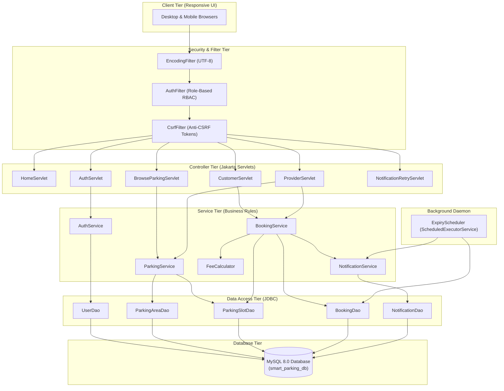

# Smart Parking Management System

[](https://www.oracle.com/java/)
[](https://tomcat.apache.org/)
[-purple.svg)](https://jakarta.ee/)
[](https://www.mysql.com/)
[](https://getbootstrap.com/)
[-brightgreen.svg)]()

---

## 1. Project Introduction

The **Smart Parking Management System** is a full-stack, enterprise-grade Java web application designed to bridge the gap between drivers seeking parking and facility owners managing parking spaces. By providing real-time slot discovery, transactional conflict-free reservations, server-side dynamic billing, and automated background expiry notifications via Email and SMS, the system modernizes urban parking operations.

---

## 2. Problem Statement

Drivers in urban areas frequently waste time and fuel cruising through busy streets without knowing if a nearby parking spot is available. Concurrently, parking garage owners manage facilities, slots, rates, and customer reservations manually using paper ledgers or disconnected spreadsheets. This lack of centralized infrastructure causes congestion, missed revenue for operators, double-booked bays, and overstay disputes.

---

## 3. Objectives and Scope

* **Centralized Discovery**: Connect drivers with parking providers through a shared portal.
* **Dynamic Slot Availability**: Calculate real-time bay availability based on operational status and overlapping reservations.
* **Transactional Concurrency**: Prevent simultaneous overlapping bookings for the same parking slot using database row locks (`SELECT ... FOR UPDATE`).
* **Automated Expiry Processing**: A background scheduler identifies expired reservations and alerts both the driver and the facility owner via Email and SMS.
* **Role-Based Security**: Strict session authentication and authorization separating Customer, Parking Provider, and Administrator roles.
* **Responsive Modern UI**: Mobile-first responsive web design built with Bootstrap 5 and Bootstrap Icons.
* **Zero Paid Dependency Requirement**: Seamless development mode with transparent notification simulation.

---

## 4. Implemented Features

### Customer / Driver Portal
* User registration with server-side field validation and BCrypt password hashing.
* Session-based login with auto-redirect to intended pages.
* Browse and search parking facilities by name, city location, price per hour, and vehicle compatibility.
* Real-time slot availability checking across custom arrival and departure intervals.
* Dynamic server-side parking fee estimation (minimum 30 minutes billing policy).
* Dynamic UPI QR Code Payment: Real-time SVG QR code generated with calculated booking fee, payee VPA, and merchant details; direct UPI app deep-linking for mobile devices.
* Secure Payment State Tracking: Captures UPI UTR reference; initializes payment in `PENDING` state until verified by the merchant ledger.
* Conflict-free slot booking with unique alphanumeric references (`BK-YYYYMMDD-XXXX`).
* Printable reservation confirmation receipt with slot identifiers, timestamps, and payment audit details.
* Comprehensive booking history segmented into status tabs with live payment status badges (`PAID`, `PENDING`, `FAILED`).
* Self-service reservation cancellation for eligible upcoming bookings (instantly releases the slot).
* Notification center displaying logs of booking confirmation and expiry alerts.
* Profile management and secure password change.

### Parking Provider Portal
* Dedicated provider registration and authenticated dashboard.
* Real-time business analytics: Total Slots, Available Slots, Active Parked Vehicles, Upcoming Bookings, Completed Bookings, Expired Bookings, Cancelled Bookings, and Total Eligible Booking Value.
* Customer Search & Lookup: Provider dashboard search allowing providers to query reservations by Customer Name, Email, Phone Number, or Booking Reference/ID with strict provider data isolation.
* Payment Audit & Manual Verification: Audit customer UPI transaction references (UTR) and verify/mark payments as `PAID` or `FAILED`.
* Facility management: Create new parking areas, modify pricing/hours/location, toggle active/inactive status.
* Bay / Slot management: Add custom bay IDs (e.g., `A-101`, `EV-01`), assign vehicle types (`CAR`, `SUV`, `EV`, `BIKE`, `ANY`), toggle active status.
* Customer booking oversight: Review all reservations placed across provider facilities with customer contact details and booking audit trails.
* Facility alert log: Receive real-time alerts when customer parking intervals expire.
* Profile and password management.

### Security and Governance
* Cryptographic BCrypt password hashing (10 salt rounds).
* CSRF token generation and validation on state-changing requests (`POST`, `PUT`, `DELETE`).
* SQL Injection prevention using `PreparedStatement` on all database interactions.
* Session fixation protection (session regeneration upon login).
* Provider data isolation: Providers cannot inspect, modify, or cancel facilities or bookings belonging to other operators.

### Automated Background Expiry Scheduler
* Java `ScheduledExecutorService` running periodic scans every 60 seconds.
* Automatically transitions confirmed reservations past their end time to `EXPIRED`.
* Dispatches four notifications per expired booking:
  1. Customer Email
  2. Customer SMS
  3. Provider Email
  4. Provider SMS
* Database-backed idempotency prevents duplicate notifications across scheduler runs or application restarts.
* Development mode transparently records messages as `SIMULATED` when external SMTP or Twilio API keys are omitted.

---

## 5. Technology Stack and Exact Versions

| Component | Technology | Exact Version | Purpose |
| :--- | :--- | :--- | :--- |
| **Language** | Java (JDK) | 25.0.2 LTS / Java 17 bytecode | Core backend logic & threading |
| **Web Container** | Apache Tomcat | 10.1.59 | Servlet 6.0 & JSP 3.1 Container |
| **Database** | MySQL Community Server | 8.0.44 | Relational persistence & constraints |
| **Database Driver** | MySQL Connector/J | 8.3.0 | JDBC driver implementation |
| **Password Hashing** | jBCrypt | 0.4 | OpenBSD-compliant password hashing |
| **Mail Dispatch** | Jakarta Mail | 2.0.1 | SMTP email notification delivery |
| **Activation API** | Jakarta Activation | 2.1.2 | MIME type and email data handler |
| **Template Engine** | Jakarta Standard Tag Library (JSTL) | 3.0.1 (GlassFish) | JSP view rendering and iteration |
| **SMS Dispatch** | Twilio REST API / HTTP | Standard Java HTTP | SMS notification delivery |
| **Unit Testing** | JUnit Jupiter & Platform | 5.10.2 / 1.10.2 | Automated unit and integration tests |
| **Frontend UI** | Bootstrap | 5.3.3 | Responsive grid, components & styling |
| **Iconography** | Bootstrap Icons | 1.11.3 | UI icons and status symbols |
| **Build Tool** | Apache Maven / PowerShell Build | 3.9.6 / `build.ps1` | Dependency management & packaging |

---

## 6. Architecture Overview

The system follows the classical **Model-View-Controller (MVC)** architectural design:

```
[ Web Browser ]
      │ (HTTP / HTTPS)
      ▼
[ AuthFilter / CsrfFilter / EncodingFilter ]
      │
      ▼
[ Java Servlets (Controllers) ]
      │
      ├───► [ Service Layer (Business Logic & Concurrency Control) ]
      │           │
      │           ├───► [ DAO Layer (PreparedStatement & JDBC) ] ───► [ MySQL 8.0 ]
      │           │
      │           └───► [ Notification Engine (Email & SMS) ]
      │
      ▼
[ JSP Views + Bootstrap 5 ] ─── (HTML / CSS / JS Output) ───► [ Browser ]

[ Background ExpiryScheduler ] ── (60s Timer) ──► [ BookingDao ] ──► [ NotificationService ]
```

---

## 7. Mermaid Architecture Diagram



---

## 8. Actual Directory Structure

```
smart_parking_system/
├── .env.example                               # Configuration environment template
├── .gitignore                                 # Git exclusions for build, secrets, IDEs
├── pom.xml                                    # Maven dependency & WAR packaging descriptor
├── build.ps1                                  # Automated standalone build, test & packaging script
├── README.md                                  # Complete operational manual
├── AGENTS.md                                  # Instructions for future AI agents
├── HELPING_ME.md                              # Practical guide & viva prep for students
├── database/
│   ├── schema.sql                             # DDL database schema with foreign keys and indexes
│   └── sample_data.sql                        # Seed data (Demo accounts with Password@123)
├── docs/
│   ├── PROJECT_OVERVIEW.md                    # Project requirements, scope & feature status matrix
│   ├── ARCHITECTURE.md                        # Architectural patterns, security & concurrency
│   ├── DATABASE.md                            # Entity-Relationship dictionary & schemas
│   └── API_AND_WORKFLOWS.md                   # Controller routes, workflows & payloads
├── lib/                                       # Core offline JAR dependencies & test runner
│   ├── jakarta.activation-api-2.1.2.jar
│   ├── jakarta.mail-2.0.1.jar
│   ├── jakarta.servlet.jsp.jstl-3.0.1.jar
│   ├── jakarta.servlet.jsp.jstl-api-3.0.0.jar
│   ├── jbcrypt-0.4.jar
│   ├── junit-platform-console-standalone-1.10.2.jar
│   └── mysql-connector-j-8.3.0.jar
├── src/
│   ├── main/
│   │   ├── java/com/smartparking/
│   │   │   ├── config/                        # AppConfig, DatabaseConnection
│   │   │   ├── controller/                    # HomeServlet, BrowseParkingServlet, AuthServlet, CustomerServlet, ProviderServlet, NotificationRetryServlet
│   │   │   ├── dao/                           # UserDao, ParkingAreaDao, ParkingSlotDao, BookingDao, NotificationDao
│   │   │   ├── filter/                        # AuthFilter, CsrfFilter, EncodingFilter
│   │   │   ├── model/                         # User, ParkingArea, ParkingSlot, Booking, Notification, DashboardStats
│   │   │   ├── notification/                  # EmailService, SmsService, DispatchResult
│   │   │   ├── scheduler/                     # ExpiryScheduler, AppLifecycleListener
│   │   │   ├── service/                       # AuthService, ParkingService, BookingService, NotificationService
│   │   │   └── util/                          # BCrypt, PasswordUtil, FeeCalculator, ValidationUtil, DateTimeUtil, CsrfTokenUtil
│   │   ├── resources/
│   │   │   └── db.properties                  # Database and messaging fallback properties
│   │   └── webapp/
│   │       ├── index.jsp                      # Entry-point redirector to /home
│   │       ├── assets/
│   │       │   ├── css/style.css              # Custom responsive stylesheet & badge styles
│   │       │   └── js/main.js                 # Live client fee calculation & UI confirmations
│   │       └── WEB-INF/
│   │           ├── web.xml                    # Servlet 6.0 deployment descriptor & error routing
│   │           ├── lib/                       # Runtime webapp libraries
│   │           └── views/
│   │               ├── home.jsp               # Landing page with hero banner & featured areas
│   │               ├── browse.jsp             # Search & filter parking facilities
│   │               ├── parking-details.jsp    # Facility overview & real-time interval slot selector
│   │               ├── auth/
│   │               │   ├── login.jsp          # Sign-in with quick-fill demo buttons
│   │               │   └── register.jsp       # Account creation (Driver vs. Provider)
│   │               ├── customer/
│   │               │   ├── dashboard.jsp      # Customer dashboard
│   │               │   ├── booking-form.jsp   # Reservation review & live fee estimator
│   │               │   ├── booking-confirmation.jsp # Receipt with reference code
│   │               │   ├── bookings.jsp       # Reservation history with status tabs
│   │               │   ├── profile.jsp        # Customer profile & password change
│   │               │   └── notifications.jsp  # Customer notification history
│   │               ├── provider/
│   │               │   ├── dashboard.jsp      # Provider analytics & stats
│   │               │   ├── manage-areas.jsp   # Facilities list & add/edit modals
│   │               │   ├── manage-slots.jsp   # Slot configurations & active toggles
│   │               │   ├── bookings.jsp       # Customer reservations list
│   │               │   ├── booking-details.jsp # Full reservation audit
│   │               │   ├── profile.jsp        # Provider company profile
│   │               │   └── notifications.jsp  # Provider slot expiry alert logs
│   │               └── common/
│   │                   ├── header.jsp         # Global navigation & flash alerts
│   │                   ├── footer.jsp         # Global footer
│   │                   ├── 404.jsp            # Not found page
│   │                   ├── 403.jsp            # Access forbidden page
│   │                   └── 500.jsp            # Internal server error page
│   └── test/
│       └── java/com/smartparking/
│           ├── model/ModelAndSecurityTest.java
│           ├── notification/NotificationSimulationAndRetryTest.java
│           ├── service/BookingConflictLogicTest.java
│           └── util/
│               ├── FeeCalculatorTest.java
│               ├── PasswordUtilTest.java
│               └── ValidationUtilTest.java
```

---

## 9. Database Tables and Relationships

### Relational Schema Summary
1. **`users`**: Stores user credentials, phone numbers, roles (`CUSTOMER`, `PROVIDER`, `ADMIN`), and account statuses (`ACTIVE`, `SUSPENDED`).
2. **`parking_areas`**: Stores facilities owned by providers with price per hour, location, hours, and status. Foreign key to `users.user_id`.
3. **`parking_slots`**: Individual bays under a parking area with vehicle type and status. Composite unique key `(parking_area_id, slot_number)` prevents duplicate slot numbers.
4. **`bookings`**: Customer reservations with unique reference, foreign keys to user, parking area, and slot. Start and end times, duration, calculated fee, lifecycle status (`CONFIRMED`, `COMPLETED`, `CANCELLED`, `EXPIRED`), and payment audit fields (`payment_status` ['PENDING', 'PAID', 'FAILED'], `payment_method`, `payment_reference`, `paid_at`).
5. **`notifications`**: Outbound email and SMS dispatches with delivery status (`SENT`, `SIMULATED`, `FAILED`, `RETRYING`), attempt counts, timestamps, and error summaries. Composite unique key `(booking_id, recipient_user_id, channel, notification_type)` prevents duplicate alerts.

---

## 10. Prerequisites

Before running the application, ensure your environment has:
* **Java Development Kit (JDK)**: Version 17, 21, or 25 LTS installed.
* **Apache Tomcat**: Version 10.1.x (Jakarta EE 10 compatible). Pre-installed at `C:\apache-tomcat-10.1.59` on this machine.
* **MySQL Community Server**: Version 8.0+ installed and running on port 3306.
* **Git**: Installed for version control.
* **Web Browser**: Chrome, Edge, Firefox, or Safari.

---

## 11. Java and Maven Setup

Verify your Java installation:
```bash
java -version
javac -version
```
Set `JAVA_HOME` environment variable (if not already set):
```powershell
$env:JAVA_HOME = "C:\Program Files\Java\jdk-25.0.2"
$env:PATH = "$env:JAVA_HOME\bin;$env:PATH"
```

---

## 12. MySQL Installation and Configuration

Ensure MySQL Server 8.0 is running as a service or process:
```powershell
# Verify MySQL Client
& "C:\Program Files\MySQL\MySQL Server 8.0\bin\mysql.exe" --version
```

If MySQL is running on a custom port or requires a root password, note your credentials for the next step.

---

## 13. Database Creation and Import Commands

Run the following commands using the MySQL CLI or MySQL Workbench:

```powershell
# 1. Import Schema DDL
& "C:\Program Files\MySQL\MySQL Server 8.0\bin\mysql.exe" -u root -p < database/schema.sql

# 2. Import Seed Development Data
& "C:\Program Files\MySQL\MySQL Server 8.0\bin\mysql.exe" -u root -p < database/sample_data.sql
```

Alternatively, open `database/schema.sql` and `database/sample_data.sql` in **MySQL Workbench** and execute them in order.

---

## 14. Environment and Configuration Instructions

Configuration values can be supplied via environment variables, `.env`, or `src/main/resources/db.properties`.

Default settings in `src/main/resources/db.properties`:
```properties
db.host=localhost
db.port=3306
db.name=smart_parking_db
db.user=root
db.password=root

app.env=development
mail.enabled=false
sms.enabled=false
scheduler.enabled=true
scheduler.intervalSeconds=60
```

To customize, adjust `db.properties` or set environment variables:
```powershell
$env:DB_USER = "root"
$env:DB_PASSWORD = "your_mysql_password"
```

---

## 15. Build Instructions

### Option A: Using the Automated PowerShell Build Script
Run the automated build script which verifies tools, compiles sources, executes the JUnit 5 test suite, and packages the WAR:
```powershell
.\build.ps1
```

### Option B: Using Maven
If Apache Maven is installed in your system PATH:
```bash
mvn clean package
```

Both build options compile the code and generate `target/smart-parking.war`.

---

## 16. WAR Packaging and Tomcat Deployment

1. **Deploy to Tomcat**:
   Copy the generated WAR file into your Tomcat `webapps/` folder:
   ```powershell
   Copy-Item "target/smart-parking.war" -Destination "C:\apache-tomcat-10.1.59\webapps\" -Force
   ```

2. **Start Apache Tomcat**:
   ```powershell
   & "C:\apache-tomcat-10.1.59\bin\startup.bat"
   ```

3. **Verify Deployment**:
   Tomcat automatically expands `smart-parking.war` into `C:\apache-tomcat-10.1.59\webapps\smart-parking\`.
   The `AppLifecycleListener` will log:
   `Smart Parking Management System initialization complete.`
   `Starting ExpiryScheduler background task (runs every 60 seconds)...`

---

## 17. Exact Local URL to Open

Open your browser and navigate to:
```
http://localhost:8080/smart-parking/
```

---

## 18. Customer Registration and Login Instructions

1. Navigate to `http://localhost:8080/smart-parking/register`.
2. Select **Customer / Driver** role.
3. Enter your full name, email, mobile phone number, and password (at least 6 characters).
4. Click **Register Account**.
5. Log in with your email and password, or use the **Driver Demo** quick-fill button on the login page:
   * **Email**: `customer@smartparking.com`
   * **Password**: `Password@123`
6. You will be redirected to the **Customer Dashboard**.

---

## 19. Provider Registration and Login Instructions

1. Navigate to `http://localhost:8080/smart-parking/register`.
2. Select **Parking Provider** role.
3. Enter company/owner name, email, phone number, and password.
4. Click **Register Account**.
5. Or use the **Provider Demo** quick-fill button on the login page:
   * **Email**: `provider@smartparking.com`
   * **Password**: `Password@123`
6. You will be redirected to the **Provider Dashboard**.

---

## 20. How to Create a Parking Area and Slots

1. Log in as a Provider.
2. In the navbar, click **Manage Facilities** (`/provider/areas`).
3. Click **Add New Facility** button.
4. Enter Facility Name (e.g., `Westside Parking Complex`), location, hourly rate (e.g., `4.50`), operating details (e.g., `24/7 Operations`), and description. Click **Create Facility**.
5. Navigate to **Manage Slots** (`/provider/slots`).
6. Select your facility from the dropdown and click **Add Slot**.
7. Enter a Bay Identifier (e.g., `W-01`, `W-02`, `EV-1`) and designate vehicle type (`CAR`, `SUV`, `EV`, `BIKE`). Click **Create Slot**.

---

## 21. How to Create and Cancel a Booking

### Creating a Booking
1. Log in as a Customer.
2. Click **Browse Parking** in the navbar.
3. Choose a facility and click **Check Slots & Reserve**.
4. Select arrival (start) and departure (end) dates and times.
5. Review the live estimated fee.
6. Select an available slot bay and click **Reserve**.
7. On the confirmation screen, click **Confirm & Save Reservation**.
8. View and print your confirmation receipt with unique booking reference code (e.g., `BK-20261029-4821`).

### Cancelling a Booking
1. In the customer navbar, click **My Bookings**.
2. Locate any upcoming confirmed reservation.
3. Click the **Cancel** button, provide an optional cancellation reason, and confirm.
4. The status changes to `CANCELLED`, and the slot is immediately released for other drivers.

---

## 22. How Expiry Processing Works

1. The `ExpiryScheduler` runs in the background every 60 seconds.
2. It queries MySQL for reservations where `booking_status = 'CONFIRMED'` and `end_time <= NOW()`.
3. In an atomic transaction (`Connection.setAutoCommit(false)`), it:
   * Updates booking status to `EXPIRED`.
   * Creates 4 notification records:
     * Customer Email
     * Customer SMS
     * Provider Email
     * Provider SMS
   * Commits the transaction.
4. It invokes `NotificationService` to deliver the messages.
5. If messaging credentials are not configured, it records delivery status as `SIMULATED` with an audit summary.

---

## 23. How to Configure Email Notifications

To send real emails via SMTP (e.g., Gmail):
1. In `src/main/resources/db.properties` or environment variables:
   ```properties
   mail.enabled=true
   mail.smtp.host=smtp.gmail.com
   mail.smtp.port=587
   mail.smtp.auth=true
   mail.smtp.starttls=true
   mail.username=your_gmail_address@gmail.com
   mail.password=your_16_digit_app_password
   mail.from=your_gmail_address@gmail.com
   mail.fromName=Smart Parking System
   ```
2. Rebuild the application using `./build.ps1`.

---

## 24. How to Configure SMS Notifications

To send real SMS alerts via Twilio:
1. Sign up at [Twilio](https://www.twilio.com) and acquire your Account SID, Auth Token, and Twilio phone number.
2. In `db.properties` or environment variables:
   ```properties
   sms.enabled=true
   sms.twilio.accountSid=ACXXXXXXXXXXXXXXXXXXXXXXXXXXXXXXXX
   sms.twilio.authToken=your_twilio_auth_token
   sms.twilio.fromNumber=+1234567890
   ```
3. Rebuild the application using `./build.ps1`.

---

## 25. How to Test in Development Mode Without Credentials

The application is pre-configured to run out of the box in Development Mode without requiring paid third-party accounts:
* `mail.enabled=false` and `sms.enabled=false`.
* Notifications are logged to the standard console output and saved to the database with `delivery_status = 'SIMULATED'`.
* Both Customers and Providers can inspect simulated dispatches in their respective **Notification History** pages (`/customer/notifications` and `/provider/notifications`).

---

## 26. Testing Commands

Execute the automated test suite at any time:
```powershell
.\build.ps1
```
Or directly via the standalone JUnit console runner:
```powershell
$jars = (Get-ChildItem -Path "lib/*.jar", "src/main/webapp/WEB-INF/lib/*.jar" | Select-Object -ExpandProperty FullName) -join ';'
$cp = "target/classes;target/test-classes;$jars;C:\apache-tomcat-10.1.59\lib\servlet-api.jar;C:\apache-tomcat-10.1.59\lib\jsp-api.jar"
& "C:\Program Files\Java\jdk-25.0.2\bin\java.exe" -jar "lib/junit-platform-console-standalone-1.10.2.jar" execute --class-path $cp --scan-class-path --fail-if-no-tests
```

**Results**: 22 passed, 0 failed.

---

## 27. Troubleshooting Common Errors

| Symptom | Cause | Solution |
| :--- | :--- | :--- |
| **`HTTP 404 Not Found`** | Context path mismatch | Ensure URL is `http://localhost:8080/smart-parking/` (WAR name is `smart-parking.war`). |
| **`CommunicationsException: Communications link failure`** | MySQL Server is stopped or wrong port | Verify MySQL service is active on port 3306. Check `db.properties`. |
| **`Access denied for user 'root'@'localhost'`** | Incorrect MySQL password | Update `db.password` in `db.properties` or set `$env:DB_PASSWORD`. |
| **`CSRF validation failed`** | Missing or expired session token | Ensure cookies are enabled in your browser and refresh the form. |
| **`UnsupportedClassVersionError`** | Tomcat running on an older JDK than compiler | Ensure Tomcat uses the same Java 17+ runtime as `javac`. |

---

## 28. UPI QR Payment and Provider Verification Workflow

### Payment Architecture
1. **Dynamic QR Code Generation**: Pure Java QR Code generator (`QrCodeUtil`) encodes RFC-compliant UPI payment intent URIs into crisp, scalable SVG images with zero external network dependencies.
2. **Payment State Separation**:
   * `PENDING`: Initial status upon customer reservation; indicates payment intent submitted with a recorded UTR transaction reference, awaiting merchant ledger reconciliation.
   * `PAID`: Confirmed upon manual provider audit or bank settlement.
   * `FAILED`: Marked if the driver fails to transfer funds or the transaction reference is invalid.
3. **Manual Verification Workflow**: The parking provider audits customer transaction references in the Provider Portal (`/provider/booking-details?id=...`) and clicks "Verify & Mark Paid" or "Mark Failed".
4. **Automated Gateway Integration Options**: To replace manual ledger reconciliation with real-time automatic confirmation, parking operators can configure webhook endpoints connected to a certified Payment Aggregator (e.g., Razorpay, Cashfree, or Paytm UPI Webhook API).

---

## 29. Security Considerations

* **Password Protection**: Passwords are never stored in plain text. Hashed using BCrypt with 10 salt rounds.
* **SQL Injection Prevention**: All queries use parameterized `PreparedStatement`. No string concatenation in SQL.
* **XSS Prevention**: Output in JSP is rendered using expression escaping and standard tag libraries.
* **CSRF Mitigation**: Anti-CSRF tokens generated with cryptographically secure random bytes and checked on every state-changing POST request.
* **Session Security**: Session cookies configured with `HttpOnly=true` to mitigate client-side script theft.
* **Data Isolation**: Strict server-side ownership checks ensure providers can only access their own facilities, bays, and bookings.

---

## 29. Known Limitations

1. **Physical Departure Detection**: The system tracks scheduled reservation end times. A booking reaching its end time does not certify that a vehicle physically left the bay without dedicated ultrasonic or camera IoT sensors.
2. **Payment Gateway**: Online credit card payment is omitted by design for academic suitability; fees are calculated and tracked as reservation valuation.
3. **Single Timezone**: The initial version calculates timestamps using server local/UTC time.

---

## 30. Future Improvements

* Integration with Razorpay / Stripe for online credit card payment.
* IoT ground sensor integration via MQTT for real-time bay occupancy detection.
* License plate recognition (ANPR) camera integration for automated barrier gate entry.
* Multi-language support (i18n).

---

## 31. Instructions for Stopping the Application

To shut down Apache Tomcat:
```powershell
& "C:\apache-tomcat-10.1.59\bin\shutdown.bat"
```
The `AppLifecycleListener` will automatically terminate the `ExpiryScheduler` thread pool cleanly.

---

## 32. GitHub Setup and Contribution Instructions

1. Initialize and commit files:
   ```bash
   git add .
   git commit -m "feat: complete end-to-end Smart Parking Management System"
   ```
2. Create a repository on GitHub.
3. Link your remote and push:
   ```bash
   git remote add origin https://github.com/your-username/smart-parking-management-system.git
   git branch -M main
   git push -u origin main
   ```
