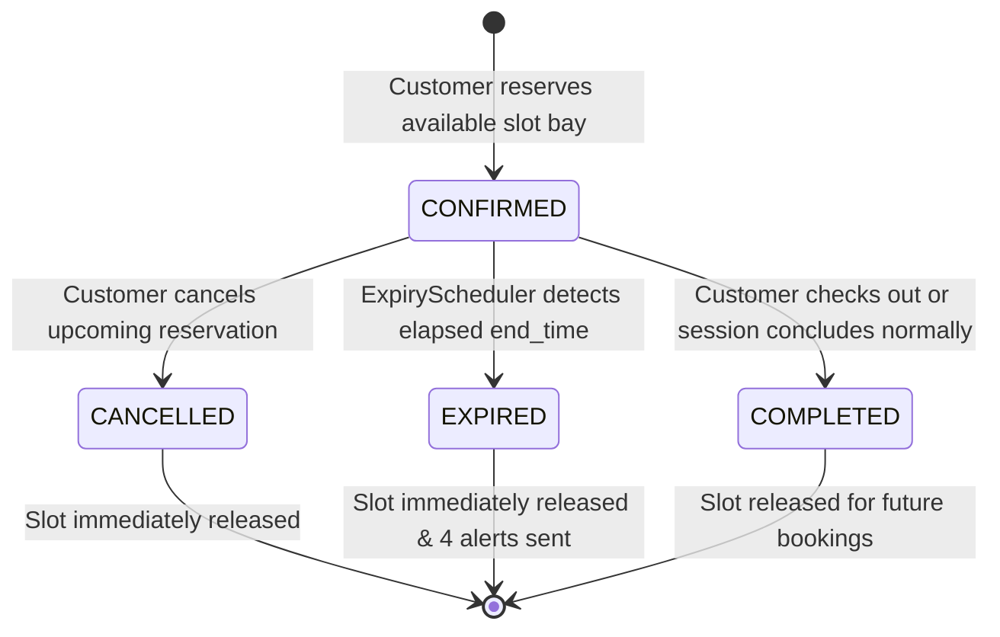
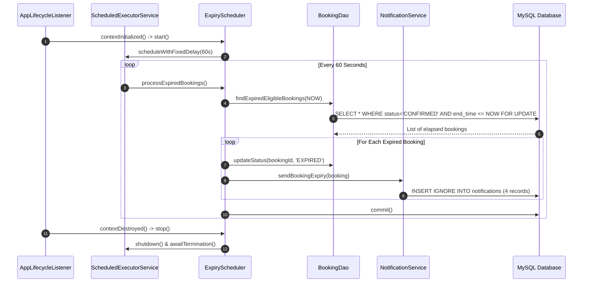

# System Architecture Specification

## 1. Architectural Style & Design Principles

The **Smart Parking Management System** adheres to a clean, decoupled **Model-View-Controller (MVC)** architectural pattern built natively on the **Jakarta EE 10 / Servlet 6.0** specification.

```
┌────────────────────────────────────────────────────────┐
│                      Client Tier                       │
│        HTML5 / CSS3 / JavaScript / Bootstrap 5         │
└──────────────────────────┬─────────────────────────────┘
                           │ (HTTP/1.1 & HTTPS)
┌──────────────────────────▼─────────────────────────────┐
│                    Filter Chain                        │
│  EncodingFilter ──► AuthFilter ──► CsrfFilter          │
└──────────────────────────┬─────────────────────────────┘
                           │
┌──────────────────────────▼─────────────────────────────┐
│                   Controller Tier                      │
│     HomeServlet | BrowseServlet | AuthServlet          │
│     CustomerServlet | ProviderServlet | RetryServlet   │
└──────────────┬───────────────────────────┬─────────────┘
               │ (Forwards)                │ (Invokes)
┌──────────────▼────────────┐ ┌────────────▼─────────────┐
│        View Tier          │ │       Service Tier       │
│  JSP Pages + JSTL 3.0     │ │ AuthService, ParkService │
│  Responsive UI Components │ │ BookingService, NotifSvc │
└───────────────────────────┘ └────────────┬─────────────┘
                                           │
                              ┌────────────▼─────────────┐
                              │     Data Access Tier     │
                              │ UserDao, ParkingAreaDao  │
                              │ SlotDao, BookingDao      │
                              │ NotificationDao          │
                              └────────────┬─────────────┘
                                           │ (JDBC 4.3)
                              ┌────────────▼─────────────┐
                              │      Database Tier       │
                              │        MySQL 8.0         │
                              └──────────────────────────┘
```

---

## 2. Concurrency & Transaction Management

A core challenge in parking reservation systems is preventing **race conditions** (two drivers reserving the same slot for the same time window simultaneously).

### Concurrency Isolation Strategy
1. **Explicit Transaction Boundaries**: The Service layer manages connection transactions explicitly by invoking `Connection.setAutoCommit(false)`.
2. **Pessimistic Row-Level Locking**: Before saving a new booking record, the system queries MySQL with `SELECT ... FOR UPDATE`:
   ```sql
   SELECT 1 FROM bookings
   WHERE slot_id = ?
     AND booking_status = 'CONFIRMED'
     AND start_time < ?
     AND end_time > ?
   LIMIT 1
   FOR UPDATE;
   ```
3. **Commit or Rollback**:
   * If a matching row is returned, the slot is locked and occupied. The transaction is immediately rolled back (`conn.rollback()`), and an `IllegalArgumentException` is thrown.
   * If no conflicting row is found, the new booking is inserted, and the transaction is committed (`conn.commit()`).

---

## 3. Booking Lifecycle State Machine



* **CONFIRMED**: Active reservation blocking the assigned slot bay for the interval $[start\_time, end\_time]$.
* **CANCELLED**: Released by driver prior to start time. Interval is freed immediately; audit history is preserved.
* **EXPIRED**: Detected by the background scheduler when $end\_time \le NOW()$. Triggers 4-way email and SMS alerts. Slot is freed.
* **COMPLETED**: Normal session conclusion.

---

## 4. Background Expiry Scheduler Architecture



---

## 5. Security & Authentication Architecture

1. **Password Scrambling**: Utilizes OpenBSD-compliant **BCrypt** with 10 logarithmic salt rounds.
2. **Session Security**:
   * HTTP sessions configured with `HttpOnly=true` in `web.xml` to prevent client-side XSS cookie scraping.
   * Session regeneration on login prevents session fixation.
   * 30-minute idle session timeout.
3. **Role-Based Authorization (RBAC)**:
   * Filter-level interception (`AuthFilter`) protects `/customer/*`, `/provider/*`, and `/admin/*`.
   * Cross-provider isolation enforced at the DAO layer: Provider updates require `WHERE provider_id = ?`.
4. **Anti-CSRF Mitigation**:
   * Cryptographically secure 256-bit random tokens generated via `SecureRandom`.
   * Enforced across all state-changing `POST`, `PUT`, and `DELETE` requests.
