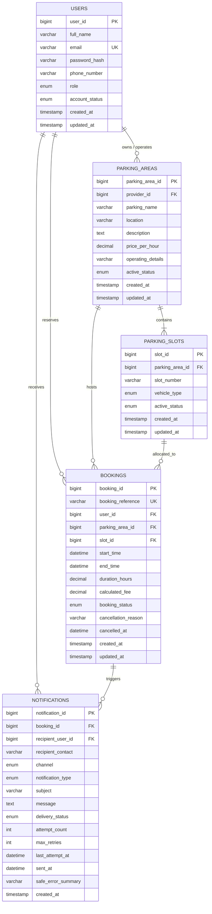

# Database Design & Data Dictionary

## 1. Overview & ER Diagram

The **Smart Parking Management System** database (`smart_parking_db`) is designed using **MySQL 8.0** with the `InnoDB` storage engine. It provides strict referential integrity, cascading updates, composite uniqueness constraints, and specialized indexes for high-throughput reservation lookups.



---

## 2. Detailed Data Dictionary

### Table: `users`
Stores credentials, profile details, and role assignments.

| Column | Type | Nullable | Constraints / Default | Description |
| :--- | :--- | :--- | :--- | :--- |
| `user_id` | `BIGINT` | NO | `PRIMARY KEY AUTO_INCREMENT` | Unique identifier for user |
| `full_name` | `VARCHAR(100)` | NO | None | Legal or display name |
| `email` | `VARCHAR(150)` | NO | `UNIQUE KEY` | Unique login email |
| `password_hash`| `VARCHAR(255)`| NO | None | BCrypt hash with 10 salt rounds |
| `phone_number` | `VARCHAR(20)` | NO | None | SMS delivery destination |
| `role` | `ENUM` | NO | `DEFAULT 'CUSTOMER'` | `'CUSTOMER'`, `'PROVIDER'`, `'ADMIN'` |
| `account_status`|`ENUM` | NO | `DEFAULT 'ACTIVE'` | `'ACTIVE'`, `'SUSPENDED'`, `'INACTIVE'` |
| `created_at` | `TIMESTAMP` | NO | `DEFAULT CURRENT_TIMESTAMP` | Account creation timestamp |
| `updated_at` | `TIMESTAMP` | NO | `DEFAULT CURRENT_TIMESTAMP ON UPDATE CURRENT_TIMESTAMP` | Last modified timestamp |

---

### Table: `parking_areas`
Parking garages or surface lots owned by parking providers.

| Column | Type | Nullable | Constraints / Default | Description |
| :--- | :--- | :--- | :--- | :--- |
| `parking_area_id`| `BIGINT` | NO | `PRIMARY KEY AUTO_INCREMENT` | Unique facility identifier |
| `provider_id` | `BIGINT` | NO | `FOREIGN KEY (users.user_id)` | Provider owner identifier |
| `parking_name` | `VARCHAR(150)`| NO | None | Facility name |
| `location` | `VARCHAR(255)`| NO | None | Street address or geographic location |
| `description` | `TEXT` | YES | None | Facility amenities, CCTV, access rules |
| `price_per_hour`| `DECIMAL(10,2)`| NO | None | Hourly parking rate ($) |
| `operating_details`|`VARCHAR(255)`|NO | `DEFAULT '24/7 Operations'` | Operating schedule description |
| `active_status`| `ENUM` | NO | `DEFAULT 'ACTIVE'` | `'ACTIVE'`, `'INACTIVE'` |
| `created_at` | `TIMESTAMP` | NO | `DEFAULT CURRENT_TIMESTAMP` | Creation timestamp |
| `updated_at` | `TIMESTAMP` | NO | `DEFAULT CURRENT_TIMESTAMP ON UPDATE CURRENT_TIMESTAMP` | Last modified timestamp |

---

### Table: `parking_slots`
Individual parking bays within a facility.

| Column | Type | Nullable | Constraints / Default | Description |
| :--- | :--- | :--- | :--- | :--- |
| `slot_id` | `BIGINT` | NO | `PRIMARY KEY AUTO_INCREMENT` | Unique bay identifier |
| `parking_area_id`| `BIGINT` | NO | `FOREIGN KEY (parking_areas)` | Parent parking facility |
| `slot_number` | `VARCHAR(50)` | NO | Composite Unique with `area_id` | Bay label (e.g., `A-101`, `EV-01`) |
| `vehicle_type` | `ENUM` | NO | `DEFAULT 'CAR'` | `'CAR'`, `'SUV'`, `'EV'`, `'BIKE'`, `'ANY'` |
| `active_status`| `ENUM` | NO | `DEFAULT 'ACTIVE'` | `'ACTIVE'`, `'INACTIVE'` |
| `created_at` | `TIMESTAMP` | NO | `DEFAULT CURRENT_TIMESTAMP` | Creation timestamp |
| `updated_at` | `TIMESTAMP` | NO | `DEFAULT CURRENT_TIMESTAMP ON UPDATE CURRENT_TIMESTAMP` | Last modified timestamp |

---

### Table: `bookings`
Customer parking reservations across time intervals.

| Column | Type | Nullable | Constraints / Default | Description |
| :--- | :--- | :--- | :--- | :--- |
| `booking_id` | `BIGINT` | NO | `PRIMARY KEY AUTO_INCREMENT` | Internal primary key |
| `booking_reference`|`VARCHAR(50)`| NO | `UNIQUE KEY` | Public reference (e.g., `BK-20261029-4821`) |
| `user_id` | `BIGINT` | NO | `FOREIGN KEY (users.user_id)` | Driver who reserved the bay |
| `parking_area_id`| `BIGINT` | NO | `FOREIGN KEY (parking_areas)` | Associated facility |
| `slot_id` | `BIGINT` | NO | `FOREIGN KEY (parking_slots)` | Reserved bay |
| `start_time` | `DATETIME` | NO | None | Scheduled arrival date & time |
| `end_time` | `DATETIME` | NO | None | Scheduled departure date & time |
| `duration_hours`|`DECIMAL(5,2)` | NO | None | Billable hours (min 0.50) |
| `calculated_fee`|`DECIMAL(10,2)`| NO | None | Estimated fee ($) |
| `booking_status`|`ENUM` | NO | `DEFAULT 'CONFIRMED'` | `'CONFIRMED'`, `'CANCELLED'`, `'COMPLETED'`, `'EXPIRED'` |
| `cancellation_reason`|`VARCHAR(255)`|YES| None | Optional cancellation explanation |
| `cancelled_at` | `DATETIME` | YES | None | Cancellation timestamp |
| `created_at` | `TIMESTAMP` | NO | `DEFAULT CURRENT_TIMESTAMP` | Record creation timestamp |
| `updated_at` | `TIMESTAMP` | NO | `DEFAULT CURRENT_TIMESTAMP ON UPDATE CURRENT_TIMESTAMP` | Last modified timestamp |

---

### Table: `notifications`
Email and SMS dispatches and delivery audit records.

| Column | Type | Nullable | Constraints / Default | Description |
| :--- | :--- | :--- | :--- | :--- |
| `notification_id`| `BIGINT` | NO | `PRIMARY KEY AUTO_INCREMENT` | Unique notification ID |
| `booking_id` | `BIGINT` | NO | `FOREIGN KEY (bookings)` | Related booking |
| `recipient_user_id`|`BIGINT` | NO | `FOREIGN KEY (users)` | Recipient user identifier |
| `recipient_contact`|`VARCHAR(150)`|NO | None | Destination email or phone number |
| `channel` | `ENUM` | NO | None | `'EMAIL'`, `'SMS'` |
| `notification_type`|`ENUM` | NO | None | `'BOOKING_CONFIRMATION'`, `'BOOKING_EXPIRY'`, `'BOOKING_CANCELLED'` |
| `subject` | `VARCHAR(200)`| YES | None | Email subject header |
| `message` | `TEXT` | NO | None | Plaintext message payload |
| `delivery_status`| `ENUM` | NO | `DEFAULT 'PENDING'` | `'PENDING'`, `'SENT'`, `'SIMULATED'`, `'FAILED'`, `'RETRYING'` |
| `attempt_count`| `INT` | NO | `DEFAULT 0` | Transmission attempts executed |
| `max_retries` | `INT` | NO | `DEFAULT 3` | Maximum allowed retries |
| `last_attempt_at`|`DATETIME` | YES | None | Timestamp of last attempt |
| `sent_at` | `DATETIME` | YES | None | Timestamp of confirmed transmission |
| `safe_error_summary`|`VARCHAR(255)`|YES| None | Redacted error description |
| `created_at` | `TIMESTAMP` | NO | `DEFAULT CURRENT_TIMESTAMP` | Initial record creation |

---

## 3. Database Indexes for Query Optimization

```sql
-- 1. Optimizes interval overlap detection and concurrency locking
CREATE INDEX idx_bookings_slot_interval
ON bookings (slot_id, start_time, end_time, booking_status);

-- 2. Optimizes automated background expiry scan (runs every 60s)
CREATE INDEX idx_bookings_status_endtime
ON bookings (booking_status, end_time);

-- 3. Enforces idempotency to guarantee zero duplicate notifications
CREATE UNIQUE INDEX uk_notification_idempotency
ON notifications (booking_id, recipient_user_id, channel, notification_type);
```
