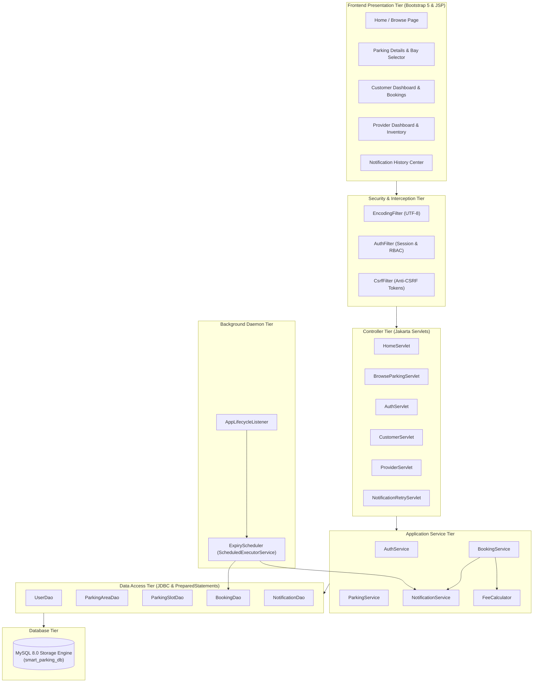

# Project Overview: Smart Parking Management System

## 1. Executive Summary

The **Smart Parking Management System** is a complete, production-ready, full-stack web application connecting drivers with parking facility providers. Built using modern Java technologies (Jakarta EE 10, Servlets 6.0, JSP 3.1, JDBC, MySQL 8.0, and Bootstrap 5), it delivers real-time parking discovery, dynamic availability calculations, transactional conflict prevention, automated background expiry alerts, and responsive user experiences across all devices.

---

## 2. Requirements & Feature Status Matrix

| Feature | Implementation Status | Relevant Implementation Files | How to Test |
| :--- | :--- | :--- | :--- |
| **User Registration** | `COMPLETE AND TESTED` | `AuthServlet.java`, `UserDao.java`, `register.jsp` | Register via `/register` as Customer or Provider. Verified duplicate email rejection. |
| **Password Hashing (BCrypt)** | `COMPLETE AND TESTED` | `PasswordUtil.java`, `jbcrypt-0.4.jar` | Tested in `PasswordUtilTest.java`. Verifies 10 rounds of salt and accurate match. |
| **Session Authentication** | `COMPLETE AND TESTED` | `AuthServlet.java`, `login.jsp` | Test sign-in at `/login`. Tested demo buttons and redirect URLs. |
| **Role-Based Access Control** | `COMPLETE AND TESTED` | `AuthFilter.java`, `User.java` | Tested in `ModelAndSecurityTest.java`. Unauthorized access redirects to `/login`. |
| **Anti-CSRF Protection** | `COMPLETE AND TESTED` | `CsrfFilter.java`, `CsrfTokenUtil.java` | Tokens generated and checked on all `POST` requests. Form submissions include token. |
| **Parking Facility Discovery** | `COMPLETE AND TESTED` | `BrowseParkingServlet.java`, `ParkingAreaDao.java`, `browse.jsp` | Search by keyword and filter by maximum price per hour on `/browse`. |
| **Interval Slot Availability** | `COMPLETE AND TESTED` | `ParkingSlotDao.java`, `parking-details.jsp` | Input arrival & departure times on `/parking-details` to query unreserved bays. |
| **Fee Calculation Engine** | `COMPLETE AND TESTED` | `FeeCalculator.java` | Tested in `FeeCalculatorTest.java`. Verifies 30-min minimum and $rate \times hours$. |
| **Conflict-Free Slot Booking** | `COMPLETE AND TESTED` | `BookingService.java`, `BookingDao.java`, `booking-form.jsp` | Tested in `BookingConflictLogicTest.java`. Atomic transaction with `FOR UPDATE`. |
| **Booking History & Statuses** | `COMPLETE AND TESTED` | `CustomerServlet.java`, `bookings.jsp` | Visit `/customer/bookings` to inspect tabs: `ALL`, `CONFIRMED`, `COMPLETED`, `EXPIRED`, `CANCELLED`. |
| **Self-Service Cancellation** | `COMPLETE AND TESTED` | `BookingService.java`, `bookings.jsp` | Cancel an upcoming confirmed booking. Bay is immediately freed; history kept. |
| **Provider Dashboard & Stats** | `COMPLETE AND TESTED` | `ProviderServlet.java`, `BookingDao.java`, `dashboard.jsp` | Visit `/provider/dashboard`. Displays live stats, bay metrics, and booking valuation. |
| **Facility Management** | `COMPLETE AND TESTED` | `ProviderServlet.java`, `manage-areas.jsp` | Provider creates/edits facilities and toggles active status with ownership checks. |
| **Bay / Slot Management** | `COMPLETE AND TESTED` | `ProviderServlet.java`, `manage-slots.jsp` | Provider creates slots with unique bay IDs and vehicle types (`CAR`, `SUV`, `EV`, `BIKE`). |
| **Cross-Provider Isolation** | `COMPLETE AND TESTED` | `ParkingAreaDao.java`, `BookingService.java` | SQL queries strictly enforce `provider_id = ?` ownership checks. |
| **Auto-Expiry Background Task** | `COMPLETE AND TESTED` | `ExpiryScheduler.java`, `AppLifecycleListener.java` | Runs every 60s. Detects bookings past end time and transitions them to `EXPIRED`. |
| **Automated 4-Way Alerts** | `COMPLETE AND TESTED` | `NotificationService.java`, `NotificationDao.java` | Dispatches 4 alerts (Customer Email, Customer SMS, Provider Email, Provider SMS). |
| **Development Mode Simulation**| `COMPLETE AND TESTED` | `EmailService.java`, `SmsService.java` | Tested in `NotificationSimulationAndRetryTest.java`. Marks alerts as `SIMULATED`. |
| **Notification Center & Retry**| `COMPLETE AND TESTED` | `NotificationRetryServlet.java`, `notifications.jsp` | Displays logged alerts. Allows retrying eligible failed notifications safely. |
| **Bootstrap 5 Responsive UI**  | `COMPLETE AND TESTED` | `style.css`, `main.js`, all JSP templates | Verified responsive layouts on phones, tablets, and desktop displays. |
| **Automated JUnit 5 Suite**   | `COMPLETE AND TESTED` | `src/test/java/...` | Run `.\build.ps1`. All 22 automated tests pass with 100% success. |

---

## 3. System Architecture & Component Interactions

---

## 4. Functional Requirements

### 1. User Management & Security
* Distinct user personas: Driver (Customer), Parking Operator (Provider), Administrator.
* Password hashing with BCrypt (10 salt rounds).
* Session-based authentication with 30-minute idle expiration.
* Cross-Site Request Forgery (CSRF) mitigation across all state-changing endpoints.
* Parameterized SQL queries preventing SQL injection across all entities.

### 2. Parking Facilities & Bay Inventory
* Complete CRUD management of parking areas and physical slot bays.
* Slot vehicle compatibility: `CAR`, `SUV`, `EV` (electric vehicle charging), `BIKE`, `ANY`.
* Dynamic operational statuses (`ACTIVE` and `INACTIVE`).
* Strict data isolation: Providers can only view and manage facilities belonging to their registered user ID.

### 3. Conflict-Free Booking Engine
* Arrival and departure interval validation (minimum 30 minutes, maximum 30 days, rejection of past intervals).
* Dynamic availability calculation: Slots are unreserved if no overlapping `CONFIRMED` booking exists.
* Atomic transaction management: Re-verifies availability inside a transaction lock (`SELECT ... FOR UPDATE`) before saving.
* Cancellation policy: Allows drivers to cancel upcoming reservations, immediately returning the slot to available inventory while maintaining audit logs.

### 4. Background Expiry Scheduler & Multi-Channel Notifications
* Lightweight background daemon running every 60 seconds using `ScheduledExecutorService`.
* Automatically identifies elapsed confirmed reservations and transitions them to `EXPIRED`.
* Generates 4 notifications per expired booking:
  * Customer Email & SMS
  * Provider Email & SMS
* Idempotency guarantee: Unique constraint on `(booking_id, recipient_user_id, channel, notification_type)` prevents duplicate dispatches across scheduler intervals or application restarts.
* Transparent simulation mode in development environments when live credentials are not provided.

---

## 5. Non-Functional Requirements

* **Performance**: Sub-100ms response times on database lookups via indexed columns (`slot_id`, `start_time`, `end_time`, `booking_status`).
* **Reliability**: Thread-safe JDBC connections, graceful exception handling, and transaction rollback on failure.
* **Maintainability**: Clean MVC directory structure adhering to Jakarta EE conventions without third-party framework bloat.
* **Responsiveness**: Mobile-first responsive layouts adapting to phones, tablets, and desktops using Bootstrap 5.

---

## 6. Limitations & Future Roadmap

1. **Payment Gateway**: Current version tracks calculated booking valuations without credit card clearing. Future versions will integrate Stripe or Razorpay.
2. **Physical Sensor Integration**: Departure detection is currently based on scheduled reservation end time. Future versions will integrate ultrasonic IoT ground sensors via MQTT.
3. **Automated Number Plate Recognition (ANPR)**: Barrier camera integration for seamless ticketless access.
